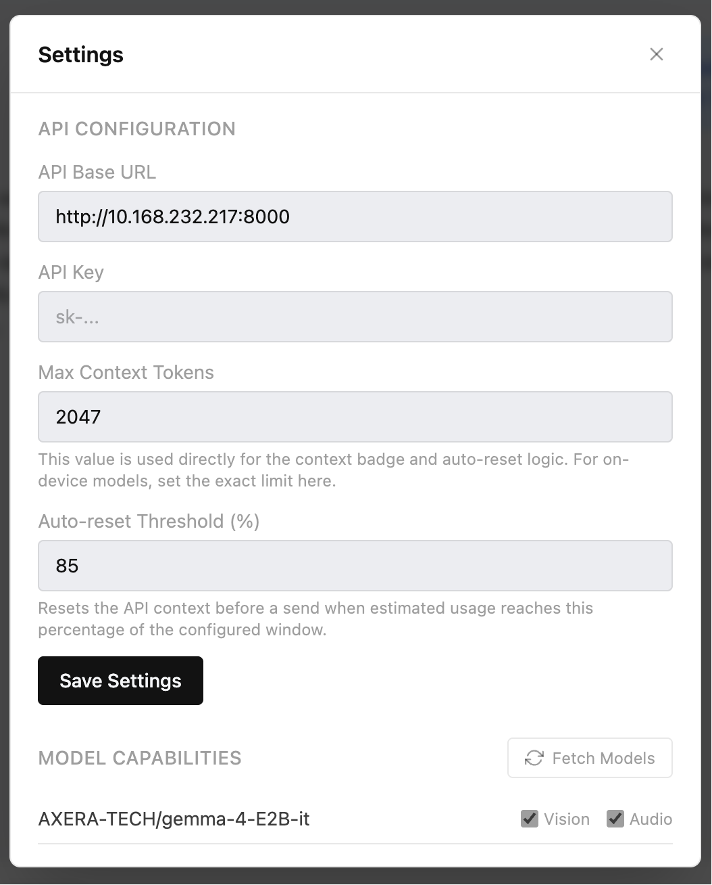

# AXERA Lite WebUI

A lightweight, local-first chat UI for OpenAI-compatible APIs.

It runs entirely in the browser, supports streaming responses and multimodal workflows, and stores conversations locally.

## Demo

The clip below shows SD 1.5 text-to-image and image-to-image generation, then PaddleOCR performing OCR on an uploaded image — all from the same interface without any page reload or configuration change.

<video src="https://github.com/AXERA-TECH/lite_webui/raw/main/assets/lite_webui_sd1.5_ocr_demo.mov" controls width="100%"></video>

> If the video does not play inline, [click here to download / view it](https://github.com/AXERA-TECH/lite_webui/raw/main/assets/lite_webui_sd1.5_ocr_demo.mov).

## Features

- OpenAI-compatible chat interface
- Streaming responses
- Configurable generation parameters and system prompt
- Markdown rendering with code highlighting and KaTeX math
- Collapsible thinking / reasoning blocks (`<think>` tags)
- Reasoning deltas (`reasoning_content`) rendered as collapsible thinking
- Image generation (Draw mode) and image-to-image via compatible image APIs
- Speech generation (Speak mode) via compatible `/v1/audio/speech` APIs
- Image upload and paste for vision-capable models
- Browser-side video frame sampling for vision backends that accept images but not native video input
- Audio transcription workflow for compatible APIs
- Automatic audio-input detection for ASR models such as Qwen3-ASR
- Multiple API endpoints with per-endpoint model management
- Model capability configuration (Vision, Audio, Draw, Speak) per endpoint
- Generated images stored as data URLs — persist after backend restart
- Local conversation history in the browser
- Conversation import and export as JSON
- Configurable context window and auto-reset threshold
- Per-response performance metrics — TTFT and decode speed — via an optional backend interface
- Light and dark themes

## Requirements

- Node.js 18+
- An OpenAI-compatible API that supports:
  - `GET /v1/models`
  - `POST /v1/chat/completions`
- Optional image generation:
  - `POST /v1/images/generations` or `POST /v1/images/edits`
- Optional audio support:
  - `POST /v1/audio/transcriptions`
- Optional speech generation:
  - `POST /v1/audio/speech`

See [API compatibility](#api-compatibility) below for the exact request shapes and
the places where Lite WebUI uses backend extensions or compatibility adaptations.

## Quick Start

```bash
npm install
npm run dev
```

Open:

```text
http://localhost:5173
```

## First-Time Setup

1. Open **Settings**.
2. Enter your **API Base URL**.
3. Enter your **API Key** if your provider requires one.
4. Set **Max Context Tokens** to the real limit of your model.
5. Adjust **Auto-reset Threshold (%)** if needed.
6. Optionally configure the system prompt, temperature, top-p, and maximum output tokens.
7. Click **Fetch Models** — this saves the endpoint and fetches available models in one step.
8. Enable the capabilities (**Vision**, **Audio**, **Draw**, **Speak**) that apply to each model.
9. Select a model from the top bar.



### API Base URL

Use the server root URL. Do **not** append `/v1`.

Correct:

```text
http://127.0.0.1:8000
http://127.0.0.1:11434
https://your-api.example.com
```

Incorrect:

```text
http://127.0.0.1:8000/v1
http://127.0.0.1:11434/v1
```

### Multiple Endpoints

Add more than one endpoint in Settings to aggregate models from different servers. The model picker groups models by endpoint and switches the active endpoint automatically when you select a model.

## API Compatibility

Lite WebUI targets a practical OpenAI-compatible subset rather than every optional
OpenAI product feature. The table below explains exactly what the browser sends.

| Capability | Endpoint / request | Compatibility |
|---|---|---|
| Model list | `GET /v1/models` | Standard. Accepts `data[].id` and the common `models[].id` fallback. |
| Chat | `POST /v1/chat/completions` with `stream: true` | Standard OpenAI Chat Completions fields: `model`, `messages`, `stream`, and optional `temperature`, `max_tokens`, `top_p`. The UI also sends `stream_options.include_usage`, which is an OpenAI field but may be ignored by lightweight backends. If a backend ignores streaming and returns normal JSON, the UI handles that fallback. |
| Reasoning | SSE `choices[].delta.reasoning_content` | Common backend extension, not part of the core OpenAI Chat Completions schema. It is rendered as a collapsible `<think>` block. |
| Vision images | Chat content parts of type `image_url` | Standard OpenAI Vision-compatible format. Images are sent as data URLs. |
| Video upload | Browser samples frames, then sends multiple `image_url` parts | Deliberate compatibility adaptation; it is **not** a native OpenAI video API. This supports vision backends that accept several images but cannot ingest a merged `video_url`. |
| Image generation | `POST /v1/images/generations` | OpenAI-compatible subset: `model`, `prompt`, `size`, `response_format`, and optional `seed`. `seed` is a backend extension used by several local inference servers. |
| Image editing | `POST /v1/images/edits` multipart | OpenAI-compatible subset: `image`, `model`, `prompt`, `size`, `response_format`, and optional `seed`. |
| Audio transcription | `POST /v1/audio/transcriptions` multipart | Standard OpenAI-compatible fields: `file`, `model`, `response_format=json`. The UI also accepts common response fields such as `text`, `transcript`, or `output_text`. |
| Speech generation | `POST /v1/audio/speech` | OpenAI-compatible subset: `model`, `input`, `response_format`, plus optional backend extension `seed`. The UI requests one complete `wav` response and does not currently use streamed PCM. |
| Performance metrics | AXERA extension fields on `usage`, or native llama.cpp top-level `timings` | Backend-reported extension. Generic OpenAI clients normally ignore unknown fields. |

### VoxCPM2 model-name compatibility

The current VoxCPM2 AX8860 server advertises a GGUF path from `/v1/models`, for example:

```text
gguf/VoxCPM2-BaseLM-F16.gguf
```

but its `/v1/audio/speech` endpoint expects the service model name:

```text
voxcpm2
```

When the selected model name contains `VoxCPM`, Lite WebUI keeps the advertised name
in the UI but sends `voxcpm2` to `/v1/audio/speech`.

## Usage

- **Send:** `Enter`
- **New line:** `Shift+Enter`
- **Reset API context only:** `/reset`
- **Clear current conversation and API context:** `/clean`

### Image Generation (Draw Mode)

- Enable **Draw** for the model in Settings.
- Click the **Draw** button in the input bar (auto-enabled for Draw-capable models).
- Optionally attach a reference image for image-to-image generation.
- Set a **seed** for reproducible results.
- Click **Regenerate** below any generated image to redraw with a new seed.

### Images

- Upload an image with the image button, or paste an image into the input box.
- The current model must have **Vision** enabled.

### Video

- Upload a video with the image button when the selected model has **Vision** enabled.
- Lite WebUI samples evenly spaced frames in the browser and sends them as multiple images.
- **Settings → Video Input** controls:
  - frames per video: `1–32`, default `8`
  - maximum long-side resolution: default `448 px`
- The original video remains visible in the chat history; only the sampled frames are sent in later API history.

### Audio

- Attach an audio file from the input bar.
- The current model must have **Audio** enabled.
- Your API must support `POST /v1/audio/transcriptions`.
- Models containing `ASR`, `Whisper`, `speech-to-text`, or `transcription` are detected automatically.
- With no text instruction, the audio transcript is shown as the assistant response.
- With a text instruction, the transcript and instruction are sent back to the selected model through `/v1/chat/completions`.

### Context reset behaviour

- `/reset` clears the API context while keeping earlier messages visible in the UI.
- Switching to a different model or endpoint also starts a fresh API context, so the `ctx` badge returns to `0`.

### Speech Generation (Speak Mode)

- Enable **Speak** for the model in Settings. Models containing `VoxCPM` or `TTS` are detected automatically.
- Click the **Speak** button in the input bar (auto-enabled for Speak-capable models).
- Enter the text to synthesize and send it.
- Play the returned audio directly in the conversation or download it as a WAV.
- A seed can be set for reproducible VoxCPM2 generation.

The frontend sends:

```json
POST /v1/audio/speech
{
  "model": "voxcpm2",
  "input": "今天天气很好。",
  "response_format": "wav"
}
```

Generated audio is kept as a browser blob for the current page session. Conversation
history stores only text and metadata, avoiding `localStorage` quota failures from
large base64 WAV files. After a page refresh, regenerate the audio if needed.

### Generation Parameters

**Settings → Generation Parameters** supports:

```text
System Prompt
Temperature
Top P
Max Output Tokens
Auto-stop on repetition
```

Empty temperature, top-p, and max-output values omit the corresponding fields and
let the backend use its default. The repetition detector is client-side and only
stops a stream after repeated output patterns; it does not change sampling parameters.

### Conversation Import / Export

- **Export** writes the current conversation to a JSON file.
- **Import** reads a conversation JSON file and creates a new local conversation.
- Generated image data and metrics are included when present. Generated speech blobs
  are intentionally not persisted because browser blob URLs are session-scoped.

### Context Badge

The `ctx x/y` badge in the input bar shows:

- current estimated context usage
- configured context window limit

When usage approaches the configured threshold, the app automatically resets API context before the next send.

## Performance Metrics (TTFT, Prefill & Decode Speed)

After each streamed chat response, a small metrics row appears under the assistant
message. Chat metrics are **data-driven**: the frontend renders one pill per metric
the backend reported, in a fixed order, and nothing when none are present:

```text
⚡ TTFT 40 ms   ·   ⤴ prefill 220 tok/s   ·   ⏱ decode 36 tok/s   ·   in 43   ·   new 15   ·   out 512
```

For chat, every TTFT, throughput, and token-count value comes directly from the backend.
The frontend never estimates or derives those values. The exception is the `time` pill
shown for speech generation: it is explicitly a client-measured end-to-end request
duration and includes network overhead.

### The interface

**Request (already sent by the frontend).** Every streaming request includes
`stream_options.include_usage`, asking the backend to emit a final usage chunk:

```jsonc
POST /v1/chat/completions
{ "model": "...", "messages": [...], "stream": true,
  "stream_options": { "include_usage": true } }
```

**Response (what the backend provides).** Lite WebUI supports two equivalent
server-reported formats.

#### Format 1: AXERA extension fields on `usage`

In the final SSE chunk (before `[DONE]`), put the fields below on the standard
`usage` object. Unknown fields are ignored by generic OpenAI clients, so this
stays fully backward-compatible:

```jsonc
data: {"choices":[],"usage":{
  "prompt_tokens": 43,          // input tokens  → "in 43"   (standard field)
  "completion_tokens": 512,     // output tokens → "out 512" (standard field)
  "total_tokens": 555,          // not displayed (redundant with in/out)
  "ttft_ms": 39.96,             // ★ time to first token, milliseconds (server prefill latency)
  "prefill_tps": 220.0,         // ★ prefill throughput, tokens per second
  "decode_tps": 36.13,          // ★ decode throughput, tokens per second
  "prefill_tokens": 15          // ★ tokens actually prefilled this turn (rest reused from KV cache)
}}

data: [DONE]
```

| Field                 | Shown as | Meaning                                                        |
| --------------------- | -------- | -------------------------------------------------------------- |
| `usage.ttft_ms`       | `TTFT`   | Time to first token in milliseconds (server-side prefill latency) |
| `usage.prefill_tps`   | `prefill`| Prefill (prompt-processing) throughput in tokens per second    |
| `usage.decode_tps`    | `decode` | Decode/generation throughput in tokens per second              |
| `usage.prompt_tokens` | `in`     | Input token count (standard OpenAI field; shown when > 0)      |
| `usage.prefill_tokens` | `new`   | Tokens actually prefilled this turn; **shown only when < `in`** (i.e. KV cache reused a prefix). Lets `prefill_tps × prefill_time` reconcile with what was really computed. |
| `usage.completion_tokens` | `out` | Output token count (standard OpenAI field; shown when > 0)     |

Field aliases also accepted: `time_to_first_token_ms` (TTFT),
`prefill_tokens_per_second` (prefill), `tokens_per_second` (decode),
`input_tokens` (in), `prefilled_tokens` (new), `output_tokens` (out).
`total_tokens` and any other keys are ignored.

#### Format 2: native llama.cpp `timings`

The AX8860 llama.cpp server also reports native timing fields at the top level of
the final SSE chunk. Lite WebUI normalizes them as follows:

```jsonc
data: {"choices":[],"usage":{
  "prompt_tokens": 16,
  "completion_tokens": 16,
  "prompt_tokens_details": { "cached_tokens": 10 }
},"timings":{
  "prompt_ms": 35.496,             // → TTFT
  "prompt_per_second": 450.755,    // → prefill
  "predicted_per_second": 129.022  // → decode
}}
```

`new` is derived only from server-reported token counts:

```text
new = usage.prompt_tokens - usage.prompt_tokens_details.cached_tokens
```

No client-side timing is used for chat metrics.

Each pill is independent, so partial data is fine — e.g. sending only `ttft_ms`
shows just the TTFT pill. Emitting none of the recognized fields shows no metrics
row at all.

## Development and Deployment

### Development

```bash
npm run dev
```

Development mode includes a built-in proxy, which is useful when your API does not allow browser CORS requests during local development.

### Production Preview

```bash
npm run build
npm run preview
```

The production build is static. Your API must allow browser access directly, be served behind a reverse proxy, or share the same origin as the frontend.

## Commands

```bash
npm run dev
npm run build
npm run preview
npm test
```

## Data Storage

Settings, model capability overrides, theme preference, and conversations are stored in your browser with `localStorage`.

Generated images are converted to base64 data URLs on receipt and stored alongside the conversation, so they remain visible even after the backend is restarted or the page is reloaded.

Generated speech is intentionally not persisted as base64. The browser blob URL is
valid only for the current page session.

Clearing site storage resets the app.

## Troubleshooting

### Fetch Models fails

- Make sure **API Base URL** does not include `/v1`.
- Confirm your API supports `GET /v1/models`.
- If it works in `npm run dev` but fails in preview or production, check CORS.

### Model list is empty

- Click **Fetch Models**.
- Verify the request succeeded.
- Confirm your API returns models from `GET /v1/models`.

### Image button is disabled

- Enable **Vision** for the selected model in **Settings**.

### Draw button is disabled

- Enable **Draw** for the selected model in **Settings**.
- Confirm your backend supports `POST /v1/images/generations`.

### Audio button is disabled

- Enable **Audio** for the selected model in **Settings**.
- Confirm your backend supports audio transcription.

### Speak button is disabled

- Enable **Speak** for the selected model in **Settings**.
- Confirm your backend supports `POST /v1/audio/speech`.

### Requests fail even though the server is reachable

Make sure your backend is compatible with the OpenAI Chat Completions format, especially `model`, `messages`, and streaming responses.

### Streaming stops with an idle-timeout warning

Lite WebUI waits a maximum of 60 seconds between streamed chunks. A healthy long
generation that keeps sending data is not interrupted. If no chunk arrives for
60 seconds, the UI preserves the partial response and shows an idle-timeout warning.

### Audio transcription succeeds but the follow-up instruction fails

When an instruction is present, Lite WebUI sends the transcript and instruction to
the selected model through `/v1/chat/completions`. A model that only implements
`/v1/audio/transcriptions` cannot process that follow-up request.

